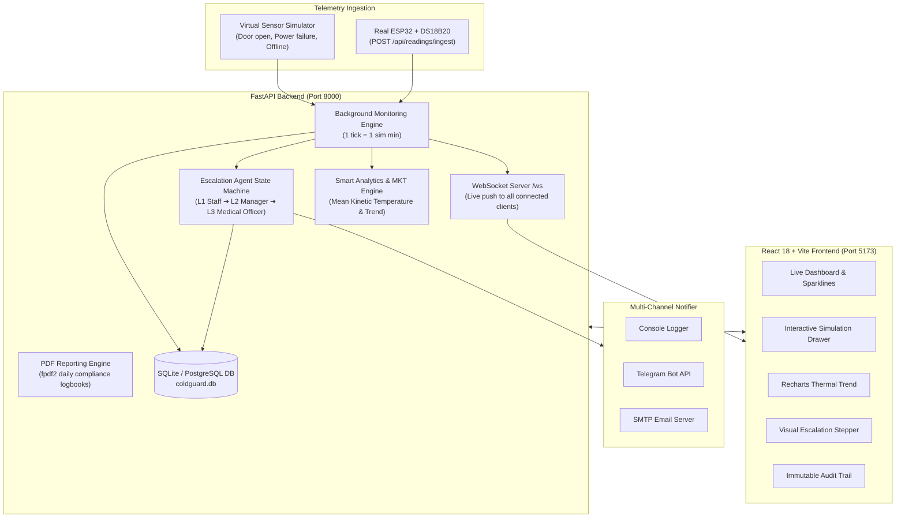
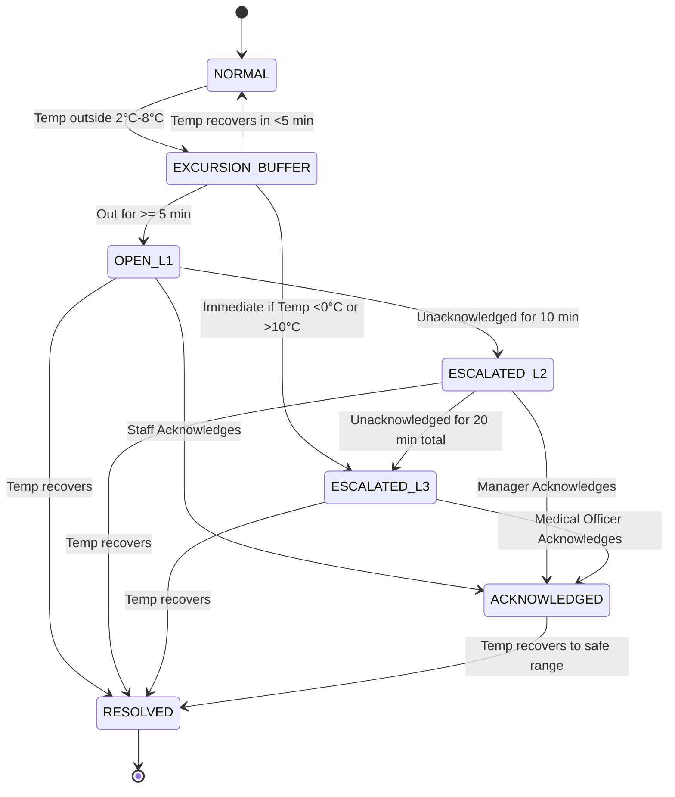

# ❄️ ColdGuard: Cold-Chain Monitoring and Escalation Agent

> Autonomous full-stack vaccine cold-chain protection system featuring real-time telemetry tracking, predictive fault diagnostics, 3-tier emergency escalation, and regulatory compliance audit logging.

Built with **FastAPI** (Python 3.11+ / 3.14), **SQLAlchemy 2.0**, **SQLite / PostgreSQL**, **WebSockets**, and **React 18 + TypeScript + Vite + Tailwind CSS**.

---

## 📋 Table of Contents
1. [Architecture Overview](#-architecture-overview)
2. [Cold-Chain Business Rules](#-cold-chain-business-rules)
3. [Escalation State Machine](#-escalation-state-machine)
4. [Demo Accounts](#-demo-accounts)
5. [Quickstart Guide (Windows PowerShell)](#-quickstart-guide-windows-powershell)
6. [API Endpoints](#-api-endpoints)
7. [Telegram Bot Integration](#-telegram-bot-integration)
8. [Automated Test Suite](#-automated-test-suite)
9. [Docker Deployment](#-docker-deployment)
10. [Hardware Extension Scope (ESP32 + MQTT)](#-hardware-extension-scope)

---

## 🏛 Architecture Overview



---

## 🎯 Cold-Chain Business Rules

| Parameter | Rule / Specification | Action Taken |
| :--- | :--- | :--- |
| **Safe Storage Range** | 2.0°C to 8.0°C (Vaccines) | Normal operation. Excursion timers are idle. |
| **Warning Thresholds** | 2.5°C (Low) / 7.5°C (High) | Visual amber indicator; early predictive warning. |
| **Critical Thresholds** | &lt; 0.0°C (Freezing risk) or &gt; 10.0°C | Immediate Level 3 critical escalation; emergency alert. |
| **Door-Open Filter** | 5-Minute buffer outside safe range | Brief spikes (&lt;5 min) do NOT alert, preventing false alarms. |
| **Escalation Level 1** | Immediate upon 5-min excursion trip | Dispatches emergency alert to **Store Staff**. |
| **Escalation Level 2** | 10 Minutes unacknowledged at Level 1 | Automatically escalates to **Store Manager**. |
| **Escalation Level 3** | 20 Minutes unacknowledged or Critical | Escalates to **Chief Medical Officer**. |
| **Reminders** | Every 10 minutes while unacknowledged | Resends reminder dispatch at the current level. |
| **Acknowledgement** | Staff / Manager logs corrective action | Immediately freezes escalation sequence & reminders. |
| **Auto-Resolution** | Temperature returns within 2.0°C–8.0°C | Alert status marked `RESOLVED`; recovery logged. |
| **Sensor Offline** | No telemetry packets for 10 minutes | Creates high-priority `SENSOR_OFFLINE` alert. |

---

## 🔄 Escalation State Machine



---

## 👥 Demo Accounts

The database comes pre-seeded with 4 default accounts:

| Role | Email | Password | Permissions |
| :--- | :--- | :--- | :--- |
| **Store Staff** | `staff@coldguard.local` | `Staff123!` | View live dashboard, inspect units, acknowledge alerts. |
| **Store Manager** | `manager@coldguard.local` | `Manager123!` | Level 2 recipient, export PDF/CSV reports, acknowledge alerts. |
| **Medical Officer** | `med@coldguard.local` | `Med123!` | Level 3 critical recipient, inspect audit logs and clinical status. |
| **System Admin** | `admin@coldguard.local` | `Admin123!` | Add/edit storage units, manage users, modify escalation contacts. |

---

## 🚀 Quickstart Guide (Windows PowerShell)

### Prerequisites
- Python 3.11+ (Check with `python --version`)
- Node.js LTS 18+ (Check with `node -v`)

### 1. Backend Setup
Open a PowerShell terminal:
```powershell
# Navigate to backend directory
cd "f:\Fundamental of ai\coldguard\backend"

# Install dependencies
python -m pip install -r requirements.txt

# Run database migrations and seed data
python -m app.db.seed

# Start FastAPI server with live reloading
python -m uvicorn app.main:app --reload --port 8000
```
- Swagger Interactive Documentation: **http://localhost:8000/docs**
- Health Check: **http://localhost:8000/api/health**

### 2. Frontend Setup
Open a second PowerShell terminal:
```powershell
# Navigate to frontend directory
cd "f:\Fundamental of ai\coldguard\frontend"

# Install node modules
npm install

# Start Vite React development server
npm run dev
```
- Application Web Portal: **http://localhost:5173**

---

## 📡 API Endpoints

- `POST /api/auth/login` – Authenticate with email & password; returns signed JWT.
- `GET /api/auth/me` – Retrieve current authenticated user profile.
- `GET /api/units` – Retrieve all active vaccine refrigerators & freezers.
- `POST /api/units` – Create a new storage unit *(Admin only)*.
- `GET /api/units/{id}/analytics` – MKT (24h), min, max, avg, rate-of-change, and predictive trend.
- `GET /api/units/{id}/readings` – Historical temperature telemetry with time-range filtering.
- `POST /api/readings/ingest` – Ingestion endpoint for ESP32 hardware sensors (protected by `X-API-Key`).
- `GET /api/alerts` – Filtered alert history (unit, severity, status, date).
- `GET /api/alerts/active` – Currently unresolved alerts.
- `POST /api/alerts/{id}/acknowledge` – Acknowledge an alert to freeze escalation.
- `GET /api/alerts/audit/log` – Immutable audit trail of all status transitions.
- `GET /api/stats/summary` – Real-time KPI counters (active alerts, excursion count, health score).
- `GET /api/reports/daily.pdf` – Download WHO-compliant daily temperature logbook PDF.
- `GET /api/reports/readings.csv` – Export raw telemetry records as CSV.
- `GET /api/reports/alerts.csv` – Export incident events as CSV.
- `POST /api/simulator/inject` – Inject fault (`door_open`, `power_failure`, `sensor_offline`, `recover`).
- `POST /api/simulator/speed` – Adjust simulation clock speed from 1x to 20x.
- `WS /ws` – WebSocket real-time telemetry stream.

---

## 🤖 Telegram Bot Integration

To receive alerts directly on your phone via Telegram:
1. Open Telegram and message **@BotFather**.
2. Run `/newbot`, name it `ColdGuard Alert Bot`, and copy the **Bot Token**.
3. Send a message to your new bot, then open:
   `https://api.telegram.org/bot<YOUR_TOKEN>/getUpdates`
   to find your `chat_id`.
4. In `coldguard/backend/.env`, set:
   ```env
   TELEGRAM_BOT_TOKEN=123456789:ABCdefGhIJKlmNoPQRsTUVwxyZ
   TELEGRAM_CHAT_IDS=987654321
   ```
5. Restart the backend. All Level 1, 2, and 3 alerts will be forwarded to your Telegram.

---

## 🧪 Automated Test Suite

Run the full pytest suite:
```powershell
cd "f:\Fundamental of ai\coldguard\backend"
python -m pytest tests/ -v
```
**Results:** 15 passed in 0.33s. Tests cover:
- Password hashing & bcrypt verification
- JWT token creation and claim decoding
- Admin & role permission barriers
- Mean Kinetic Temperature (MKT) math verification
- Normal operation without alerts
- Brief door-open excursion buffer (no false alarm)
- Power failure 3-tier escalation sequence
- Critical excursion immediate jump to Level 3
- Staff acknowledgement stopping escalation
- Automatic alert resolution upon thermal recovery
- Sensor offline detection after 10 minutes

---

## 🐳 Docker Deployment

To launch both backend and frontend in isolated containers:
```powershell
cd "f:\Fundamental of ai\coldguard"
docker compose up --build
```
- Backend runs on port 8000 with volume-persisted SQLite database.
- Frontend is compiled with a multi-stage Vite build and served via NGINX on port 80.

---

## 🔌 Hardware Extension Scope

ColdGuard is designed to transition seamlessly from simulated sensors to real physical hardware:
1. **ESP32 Microcontroller** wired to waterproof **DS18B20** digital temperature probes using the 1-Wire protocol.
2. The ESP32 connects to facility Wi-Fi and issues HTTP POST requests to:
   ```http
   POST /api/readings/ingest
   X-API-Key: dev-sensor-key
   Content-Type: application/json

   {
     "sensor_id": "ESP32-FRIDGE-A",
     "temperature": 4.15
   }
   ```
3. Alternatively, an **MQTT broker (e.g. Mosquitto)** can bridge sensor publishes directly to the ingestion pipeline.

